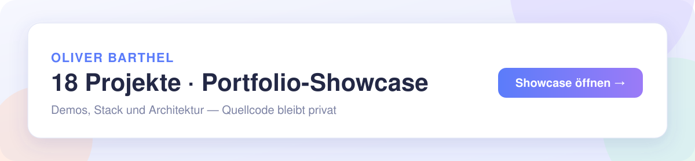

<!-- PORTFOLIO-CARD:START -->
<p align="center">
  <a href="https://project-showcase.apps.grok.bot">
    
  </a>
</p>

<p align="center">
  <strong>Portfolio-Showcase</strong> · 18 Projekte · Demos, Stack, Architektur<br/>
  <a href="https://project-showcase.apps.grok.bot"><strong>Live ansehen →</strong></a>
</p>

---
<!-- PORTFOLIO-CARD:END -->

# Oliver Barthel – Portfolio

Softwareentwickler mit Diplom in Wirtschaftsinformatik (FH Mittweida). Über 15 Jahre produktnahe IT: C#, Web, SQL, Schnittstellen, Automatisierung und KI-Workflows – von Full-Stack- und Desktop-Tools bis Mobile.

Öffentliche Showcase-Seite für Arbeitgeber und Recruiter. Quellcode bleibt privat.

**Live:** [https://project-showcase.apps.grok.bot](https://project-showcase.apps.grok.bot)

## Kurz-Biografie

Softwareentwickler und digitaler Commerce-IT-Experte mit Diplom in Wirtschaftsinformatik. Seit über 15 Jahren baue und betreibe ich produktive Systeme an der Schnittstelle von Warenwirtschaft, Onlinehandel und Automatisierung — von C#-Hilfsprogrammen und Schnittstellen bis zu Webshops, Desktop-Tools und KI-gestützten Workflows. Teamleitung in Support & Softwareentwicklung, praxisnah, eigenverantwortlich, mit Fokus auf stabile Integrationen und messbare Prozessverbesserung.

Ausführliche Fassung: [BIO.md](BIO.md)

## Inhalte

- `index.html` – Showcase (18 Projekte, Fähigkeiten, Über mich, Kontakt)
- `BIO.md` – Biografie (kurz + ausführlich)
- `assets/portfolio-card.svg` – Eyecatcher für andere Repo-READMEs
- `assets/PORTFOLIO_CARD.md` – Copy-Paste-Snippet für weitere Repos

## Lokal

```bash
python3 -m http.server 8080 --bind 127.0.0.1
```

## Kontakt

- GitHub: [github.com/oliverba81](https://github.com/oliverba81)
- Showcase: [project-showcase.apps.grok.bot](https://project-showcase.apps.grok.bot)
